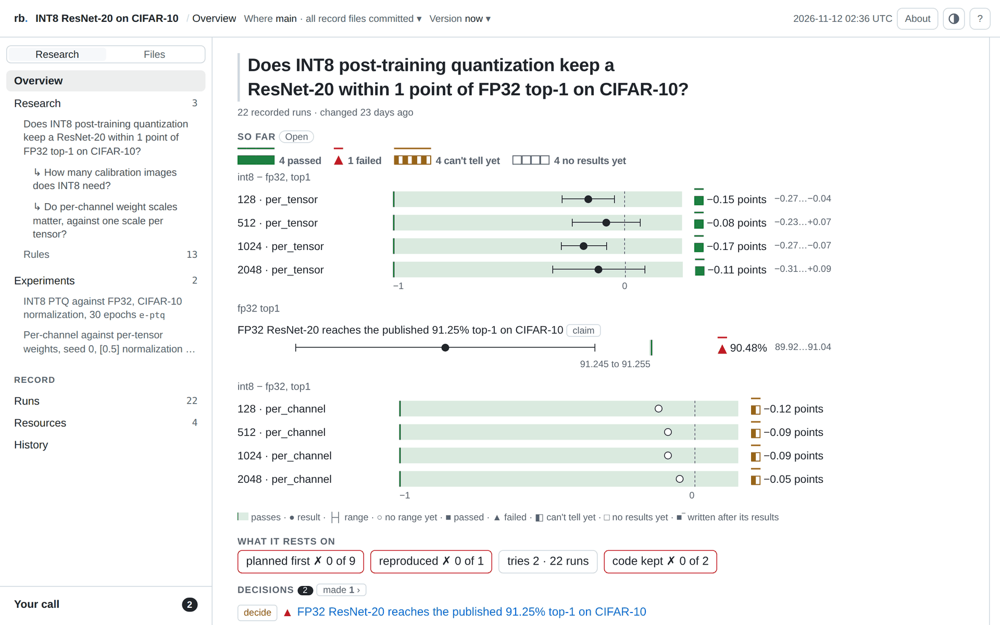

# Rabbit Brain

**Know where your research stands.** Your AI agent records what was tried, what the results show, and what's still open, with the code and settings.

<picture>
  <source media="(prefers-color-scheme: dark)" srcset="https://raw.githubusercontent.com/rabbit-brain/rb/main/docs/images/rb-open-dark.png">
  <source media="(prefers-color-scheme: light)" srcset="https://raw.githubusercontent.com/rabbit-brain/rb/main/docs/images/rb-open-light.png">
  
</picture>

## Quick start: a sample study

Try Rabbit Brain on a sample study, so you don't need to set up any experiments or use your own research. Just open Claude Code or Codex in an empty folder and paste the prompt below.

```
Clone https://github.com/rabbit-brain/think-step-by-step and work inside it.
Install rabbit-brain from PyPI into a virtual environment in that folder.
It's open source: https://github.com/rabbit-brain/rb
Start rb login in the background and show me the sign-in link it prints. I'll sign in.
When I'm signed in, run rb sync and give me the link it prints.
Run rb context and tell me in three lines what the study found and what's still open.
Don't run any experiments.
```

Your agent gives you a sign-in link (an email code, no password). Then the study opens in your private account on rabbitbrain.ai. No account? Ask your agent to run rb page instead.

## Use it on your own project

Open Claude Code or Codex in your project and paste this prompt. Then run `rb open` in your own terminal to see the record.

```
Use Rabbit Brain to keep track of the research in this repository. Record where the work stands now, from its own files.

Set up:
- If `rb --version` fails, install it with `uv tool install rabbit-brain` (or `pipx install rabbit-brain`).
- If this repository has no `.rb/` yet, run `rb init "<the work's theme>"`, then add the question the work is trying to answer with `rb question add`.
- Run `rb docs --start` and follow it. Run `rb context --model <your model id>` before anything else.

Record from the repository's own files, and cite them: the questions, the experiments with each setting and where its value came from, the rules a result must meet, and the runs. Run new experiments through `rb journal run`. Never compute findings, rankings or regressions yourself: rb computes them. Calls on results are mine. Record one only when I ask, in my words, and give me the `rb confirm` command.

If I want a page to share, run `rb page`: it writes the record's page as one file. If I want it in my rabbitbrain.ai account, run `rb login` (I approve its code myself) and then `rb sync`.

Finish with `rb status` exactly as printed, what you recorded, what rb says needs me, and where the page is if you wrote one.
```

## What rb shows you

rb works out each rule's result from the run files every time you ask. Here is `rb show` on the INT8 example further down:

```
Criterion cviuxxm on int8 (primary, own): INT8 adds at most 0.05 validation loss
  cviuxxm INT8 adds at most 0.05 validation loss
          criterion met · loss · change.val_loss ≤ 0.05 (n ≥ 3)
          reads:     change.val_loss: +0.02667 [+0.01232, +0.04101] nats · paired difference, t interval, 3 seeds, 95% (rb)
          result:    loss: the interval clear of 0 on the worse side (lower is better)
          rule:      criterion met: estimate +0.02667 ≤ 0.05
          timing:    declared after the evidence existed: 1 of 3 units was produced before it was declared; produced after it: +0.025 nats · paired difference, 2 seeds (rb)
          units:     3 seeds
          integrity: ok
  Evidence: 3 runs, each with its files unchanged and its code kept when it was recorded, after the run. rb has not rerun them.
  produced after it was declared: +0.025 nats · paired difference, 2 seeds (rb)
  runso7fgx: difference +0.03 (file) · unit seed=1 · produced before the declaration · seed=1
  runtubqyq: difference +0.02 (file) · unit seed=2 · seed=2
  run2ysivj: difference +0.03 (file) · unit seed=3 · seed=3
```

The rule allows 0.05 more validation loss. Over 3 seeds INT8 adds 0.027, so the rule is met. Seed 1 existed before the rule was written, and rb says so on every reading.

## How it works

1. Your agent writes to the record as it works. It runs experiments through `rb journal run`, sets pass marks with `rb criterion add` and leaves notes with `rb note add`.
2. rb checks the record against your repository: each setting against its config file, each result against its output file, each run against its git commit. It never edits your code.
3. The next session starts from the record. `rb context` gives a new agent the questions, the results and what is still open.
4. You make the final decisions. If your agent accepts or rejects a result, it waits until you run `rb confirm`.

The same work typed by hand, in a repository with its configs in `configs/` and each seed's results in `out/seed<N>/`:

```sh
rb init "INT8 ResNet-50"                                               # titled for the work's theme
rb question add "Is INT8 ResNet-50 as good as FP32 on ImageNet?" --id q-imagenet
rb experiment add "INT8 vs FP32" --id int8 -q q-imagenet --hypothesis "INT8 keeps validation loss within 0.05 of FP32" --baseline fp32 --candidate int8 --varies precision
rb spec set int8 --from configs/train.yaml --keys "optim.*,data.*"     # each setting read by key and checked against the file
rb spec set int8 fp32.precision fp32 --source configs/fp32.yaml#precision
rb spec set int8 int8.precision int8 --source configs/int8.yaml#precision
rb spec set int8 seed --per-run                                         # each run gives its own
rb metric add val_loss --unit nats --minimize
rb criterion add "INT8 adds at most 0.05 validation loss" -e int8 -q q-imagenet --metric change.val_loss --at-most 0.05 --min-n 3 --when-met "INT8 stays within the declared accuracy budget on ImageNet."
rb freeze int8 -m "before the held-out runs"                            # locks the rule, recorded with who froze it and why
rb run add int8 --from out/seed1/metrics.json --set seed=1 --config out/seed1/config.yaml
rb status                                                                # where the work stands, and what waits on you
rb context                                                               # what a fresh agent session reads instead of a summary
```

## The record doesn't take the agent's word

- Settings are checked against your files. A value rb can't find where it is cited shows as provisional.
- Results are worked out from the runs each time you read them. None is stored.
- A pass mark written after its results says so on every reading.
- Every decision keeps who made it and why.

## What it doesn't do

- It doesn't choose or launch your experiments. `rb journal run` only wraps a command you give it.
- It doesn't train or certify models.
- It can't record a choice that only lived in the chat.
- It sees only your repository and what runs through `rb journal run`.

## Install by hand

```sh
pip install rabbit-brain          # or: uv tool install rabbit-brain
uvx --from rabbit-brain rb tour   # a guided example, nothing installed
```

Python 3.10 or later, on Linux and macOS, and Windows as a preview.

## More

- [Docs](https://rabbitbrain.ai/docs/): every command, the record's files, sharing a record, connecting your agent.
- Usage analytics are off until you run `rb telemetry enable`. See [PRIVACY.md](https://github.com/rabbit-brain/rb/blob/main/PRIVACY.md).
- Planned: `rb paper`, a paper's rules and settings as a ready-made experiment.
- [CHANGELOG.md](https://github.com/rabbit-brain/rb/blob/main/CHANGELOG.md) · [CONTRIBUTING.md](https://github.com/rabbit-brain/rb/blob/main/CONTRIBUTING.md), with building from source.

License: [Apache-2.0](https://github.com/rabbit-brain/rb/blob/main/LICENSE)
